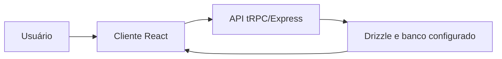

 |  | 

# Sentinela das Águas — Protótipo Web

## Visão geral

O código apresenta um protótipo de aplicação web para alertas de enchentes e monitoramento de pontos de risco: há uma tela pública de alertas com mapa e filtro por localização, e telas de painel, inspeções e relatórios. A Home atual é explicitamente uma página de exemplo. A descrição estratégica do README sobre soberania digital não é a melhor caracterização verificável do produto no código.

## Objetivo e valor

**Problema/escopo:** Protótipo web para visualizar alertas de enchentes e pontos de monitoramento em mapas, com interfaces públicas e operacionais.

**Valor verificável hoje:** o repositório torna explícitos seus artefatos, interfaces e limitações para que mantenedores e contribuidores possam avaliar o que existe sem confundir demonstração, proposta e produção.

## Arquitetura e tecnologias

Documentada em ARCHITECTURE.md, mas a documentação descreve integrações e fluxos que não estão comprovados como operacionais. A arquitetura visível no código é um cliente React/Vite em client/, servidor Express/tRPC em server/, schema Drizzle em drizzle/ e tipos compartilhados em shared/. Classificação: documentada parcialmente; tratar as descrições de serviços externos como não verificadas.

- TypeScript (linguagem reportada pelo GitHub e usada no código).
- Frontend: React 19, Vite e Tailwind CSS 4; interface com roteamento Wouter.
- Backend: Node.js/Express com tRPC; validação com Zod.
- Persistência: Drizzle ORM e schema MySQL; manifesto inclui mysql2.
- Gerenciador declarado: pnpm, com pnpm-lock.yaml.

## Início rápido

Os comandos abaixo refletem instruções, manifestos ou pontos de entrada presentes no repositório. Dependências externas, segredos e serviços estão indicados quando aplicável; a presença de um comando não equivale a uma execução validada.

1. README.md não contém instruções de instalação ou execução.
2. O manifesto declara pnpm@10.4.1 e há pnpm-lock.yaml; `pnpm install` é o comando convencional para instalar dependências, mas não está documentado no README.
3. `pnpm dev` está definido no package.json e também aparece em ARCHITECTURE.md para iniciar o servidor de desenvolvimento.
4. Outros scripts definidos no package.json: `pnpm build`, `pnpm start`, `pnpm check`, `pnpm test` e `pnpm db:push`. São scripts declarados, não comandos executados na revisão estática do repositório; dependências de ambiente/banco podem ser necessárias.

## Exemplo de uso

Exemplo possível pela interface implementada: abrir `/alerts`, acionar “Minha Localização” e ajustar o raio para filtrar alertas ativos exibidos na lista e no mapa. A página consulta `alerts.getActive`; isso descreve comportamento do código e não confirma que uma implantação pública esteja disponível ou configurada.

## Estado e limitações

**Maturidade indicada:** Protótipo.

- Home.tsx identifica seu conteúdo como exemplo e mostra “Example Page”, não a experiência de produto descrita no README.
- As telas não comprovam que todos os fluxos estejam completos: por exemplo, alertas regionais e mutations de criação/resolução no servidor contêm TODOs; o botão de notificações na página pública não tem handler visível.
- O painel mostra uma taxa de resposta fixa de 94%; não a descrever como métrica calculada sem validação adicional.
- ARCHITECTURE.md anuncia IA, Google Vertex, mapas e serviços externos, notificações e fluxos de produção; não presumir que essas integrações estejam configuradas ou operacionais apenas com base nesse documento.

## Contribuição

Leia [CONTRIBUTING.md](CONTRIBUTING.md) antes de abrir uma issue ou pull request. Para reportes de segurança, siga a orientação específica do repositório, se houver.

## Licença

Este repositório está licenciado sob **MIT**; consulte [LICENSE](LICENSE).

## Patrocínio e apoio

O desenvolvimento aberto exige tempo para manutenção, documentação, testes, revisão de contribuições e resposta a issues. Se este projeto for útil, considere apoiar a continuidade pelo [GitHub Sponsors](https://github.com/sponsors/felipetjmg1-bit). O apoio não representa promessa de funcionalidades, prazo de entrega ou suporte comercial.

